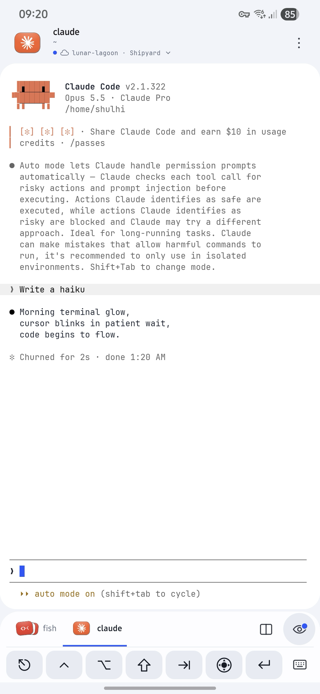
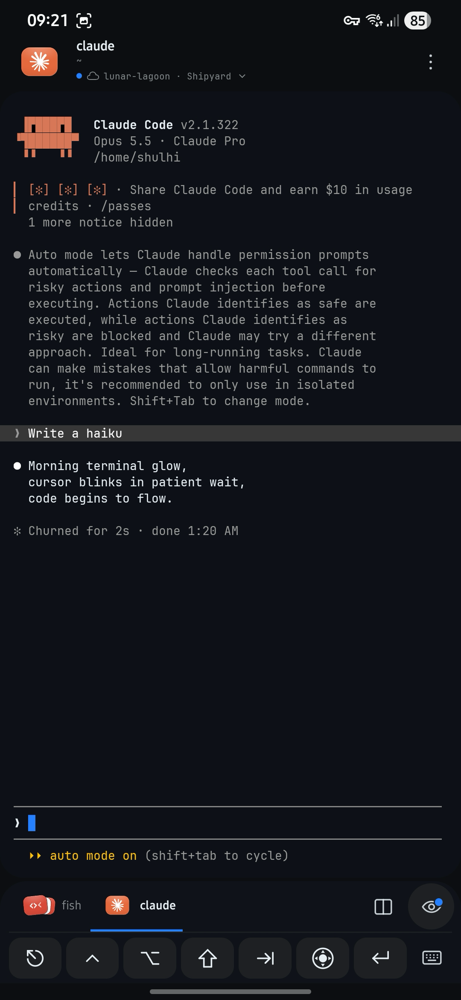

#  Rexling

## Overview

Rexling is an unofficial native Android client for Superlogical Rex.
Access your terminal sessions from your phone over Tailscale, with touch controls
for everyday shell work, Neovim, Codex and Claude.

| Light theme | Dark theme |
| :---: | :---: |
|  |  |

## Installation and build

Rexling supports **Android 9 or newer on 64-bit ARM devices**. You need a running
Rex server and Tailscale connected to the same tailnet on your phone.

### Install an APK

Download an APK from [GitHub Releases](https://github.com/shulhi/rexling/releases),
open it on your phone, and allow installation when Android asks. Open Rexling
and enter your Rex server’s private HTTPS URL. On Android 17+, allow local
network access when prompted.

### Build from source

Install Android Studio, the Android SDK/NDK, Rust, Python and curl. Exact versions
and setup instructions are in [BUILDING.md](BUILDING.md).

```sh
git clone https://github.com/shulhi/rexling.git
cd rexling
./rexling-android/scripts/gradle.sh :app:shareRelease
```

The build downloads the pinned native dependencies and produces an APK and
SHA-256 checksum in `rexling-android/dist/`. Open `rexling-android/` in Android
Studio to work on the app.

## Features

- **Servers and sessions** — connect to multiple Rex servers, create and rename
  sessions, and restore your last session, tab and pane.
- **Tabs and panes** — switch, rename and reorder terminals, preview split
  layouts, split right or below, and dock or float panes. Optional minimized
  floating panes sit in an icon dock.
- **Automatic pane takeover** — opening a pane takes control and resizes its
  terminal to fit your screen, letting terminal applications reflow their text.
- **Kitty graphics** — display terminal images through libghostty, including
  PNG/RGB/RGBA images, transparency and animation. Images restore with the
  terminal snapshot when reconnecting.
- **Touch terminal controls** — arrow joystick, precise navigation popup,
  Ctrl shortcuts, function keys and customizable Neovim shortcuts in a wheel
  or grid.
- **Image uploads** — paste or attach images to supported Rex servers, with
  upload progress and cancellation. Rex inserts the uploaded file’s path into
  the destination terminal. Requires Rex API revision 11 or newer.
- **Activity and notifications** — track working tasks, finished tasks and
  requests for attention, with optional background alerts.
- **Appearance** — light, dark and system themes, program icons and frosted
  overlays.

See the [Android guide](rexling-android/README.md) for more details.

## Project status and license

Rexling is an independent, unofficial client maintained on a **best-effort basis**.
Compatibility with future Rex versions and ongoing support are not guaranteed.
The app is provided **AS IS**, under the terms of the license.

Copyright 2026 Shulhi Sapli and contributors. Project code is licensed under
[Apache License 2.0](LICENSE). Third-party dependencies and assets retain their
own terms, listed in [THIRD_PARTY_NOTICES.md](THIRD_PARTY_NOTICES.md).
